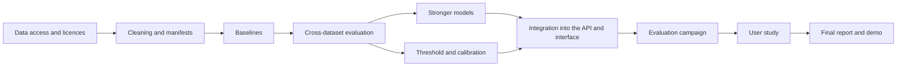

# 12-month roadmap

The plan covers a full final-year project for a team of four. Months 1 to 4 describe work that **already exists in this repository** and is marked **Done in repo**. Months 5 to 12 are the plan for what is not built. Nothing in months 5 to 12 is claimed to work today.

**Status of the repository against this plan.** Work from later months was started early so that no module remains a placeholder. In the repository today: an experimental Urdu text model (month 6), a frame-based video module with face detection, a pretrained classifier and a cross-dataset measurement (months 6 and 7), CLIP image-text consistency measured on Flickr30k (month 8), Wikipedia-based evidence retrieval with a stance model and stored sources (months 8 and 9), and a news-address and website check. They were measured on small or non-news data and are labelled experimental, heuristic or pretrained in the registry. The open items are listed in `technical_documentation/future_work.md`: a model that learns motion, audio, news-photo thresholds, a measured retrieval step, a second Urdu collection, a sandboxed video decoder, and the Docker and native Windows verification. The weekly tables below remain the plan for a team and were not rewritten.

Responsibilities use the member roles from `docs/TEAM.md`: **M1** NLP and evaluation, **M2** image and video, **M3** multimodal, evidence and explainability, **M4** frontend, backend, database and deployment. Every member also contributes to documentation, research, testing and integration each month.

## Rules that apply to every month

1. A module moves from `planned` to `experimental` when code exists, and to `trained_baseline` or `pretrained` only after it passes the evaluation protocol in `docs/research/research_methodology.md` section 5 (held-out test, external test, calibration, robustness, error analysis).
2. Weak results are reported, not hidden.
3. Each month ends with a short demo, an updated test report and an updated acceptance checklist.
4. No dataset is used before its licence or access terms are recorded in a manifest.

## Month by month

### Month 1: foundation and literature (Done in repo)

| Week | Deliverables |
|---|---|
| 1 | Repository, tooling, folder structure, `.gitignore`, team roles agreed |
| 2 | Design system (type, colour tokens, light and dark) and page inventory |
| 3 | Literature search: each member picks and verifies 10 papers in their area |
| 4 | Dataset inventory with licences and access methods. Draft requirements |

Dependencies: none. Responsibilities: all, M4 leads the repository and design. Risks: unverified references (mitigation: DOI or arXiv check for every paper). Completion criteria: 40 verified references in `docs/research/`, requirements v1.

### Month 2: application skeleton and data (Done in repo)

| Week | Deliverables |
|---|---|
| 1 | FastAPI app, error envelope, settings, SQLAlchemy models, Alembic migration 0001 |
| 2 | Authentication: register, login, logout, reset, bcrypt, token revocation (M4). Dataset download and cleaning script (M1) |
| 3 | Frontend shell: router, layouts, guards, auth pages (M4). Image forensics module, ELA and EXIF (M2) |
| 4 | Role and audit log, rate limiter, security tests (M4). Dataset manifests and leakage checks (M1) |

Dependencies: Month 1 requirements. Risks: dataset provenance unknown (mitigation: empirical label check and a manifest that says so). Completion criteria: login and image analysis work end to end, backend tests green.

### Month 3: text baseline and core pages (Done in repo)

| Week | Deliverables |
|---|---|
| 1 | TF-IDF features and four baseline classifiers with a fixed seed (M1) |
| 2 | External evaluation on LIAR2, calibration, model registry and version guard (M1, M4) |
| 3 | Text and image analysis pages, result pages with limitations, history and dashboard (M4, M1, M2) |
| 4 | Exact term explanation and its test (M3). Honest planned-module pages (M4) |

Dependencies: Month 2 pipeline. Risks: a high in-collection score mistaken for real performance (mitigation: show the external score next to it). Completion criteria: Models page shows both results, text result page explains its score.

### Month 4: reports, administration, packaging, documentation v1 (Done in repo; Docker run once in a sandbox, not on Docker Desktop; PowerShell scripts not run)

| Week | Deliverables |
|---|---|
| 1 | PDF reports, feedback and contact flow, admin overview and users (M4) |
| 2 | Browser end-to-end tests with the real backend, visual review and fixes (M4, all) |
| 3 | Dockerfiles, Compose, nginx, scripts, `.env.example`, migrations for PostgreSQL (later run on an embedded PostgreSQL 16, see testing report) (M4) |
| 4 | Documentation v1: architecture, API, database, model cards, manuals, research documents (all) |

Dependencies: Month 3 modules. Risks: Docker was run only once in a Linux sandbox and the PowerShell scripts were never executed (open, see month 5). Completion criteria: all automated suites green, documentation set complete, mid-project review passed.

### Month 5: verification of deployment and first research extensions

| Week | Deliverables |
|---|---|
| 1 | Run Docker Compose on a machine with Docker, fix what breaks. Run migrations against a live PostgreSQL (M4) |
| 2 | Native Windows run of the PowerShell scripts, fix differences (M4) |
| 3 | Urdu: acquire Ax-to-Grind Urdu and the FIRE 2020 data, record licences, write manifests (M1) |
| 4 | Video: request access to FaceForensics++, Celeb-DF and DFDC, set up a small subset and a data loader (M2). Literature update (M3) |

Dependencies: a Docker machine, dataset access forms. Risks: access refused or slow. Mitigation: start with openly downloadable subsets. Completion criteria: compose stack serves the app, Urdu and video manifests written.

### Month 6: stronger text models and calibration

| Week | Deliverables |
|---|---|
| 1 | Fine-tune a small distilled transformer on the English data with early stopping (M1) |
| 2 | Evaluate on the held-out split and LIAR2 with the same script. Compare with the baseline (M1) |
| 3 | Choose the confidence threshold with a coverage-risk curve on validation data (M1, M3) |
| 4 | Pretrained-feature image detector experiment on a small labelled set (M2). Accessibility audit of the interface (M4) |

Dependencies: Month 5 data work. Risks: no GPU, so training is slow (mitigation: small data, distilled model, short runs, report the limits). Completion criteria: a measured comparison table in `docs/technical_documentation/`, whatever the result.

### Month 7: Urdu text and video prototype

| Week | Deliverables |
|---|---|
| 1 | Urdu text baseline with a multilingual model, train on one Urdu dataset (M1) |
| 2 | Urdu cross-dataset test and error analysis (M1) |
| 3 | Video: frame sampling, face detection, a small classifier on a subset (M2) |
| 4 | Video cross-dataset test: train on one dataset, test on another (M2). Backend route gives no verdict until the gate is passed (M4) |

Dependencies: Month 5 data access. Risks: poor cross-dataset result (expected from the literature). Completion criteria: results reported honestly in the documentation. Status of video becomes `experimental` only if code exists, and a verdict is shown only if the gate is passed.

### Month 8: multimodal consistency and evidence design

| Week | Deliverables |
|---|---|
| 1 | CLIP-style feature extraction on CPU, latency measurement (M3) |
| 2 | Headline and image consistency on NewsCLIPpings with a held-out split (M3) |
| 3 | Evidence module design: source policy, retrieval method, storage in the `claims` and `evidence_sources` tables (M3, M4) |
| 4 | Claim extraction prototype (M1). Hand-checked set of 100 recent claims with fact-check labels (M3, M1) |

Dependencies: Month 6 methods. Risks: retrieval depends on network access and source quality. Completion criteria: consistency score reported with limits, evidence design reviewed.

### Month 9: integration of multimodal and evidence

| Week | Deliverables |
|---|---|
| 1 | Backend endpoints for multimodal and evidence with typed results (M4) |
| 2 | Evidence retrieval prototype that always lists its sources (M3) |
| 3 | Interface for evidence and consistency results, replacing the planned pages only if the gate is passed (M4) |
| 4 | Faithfulness checks of explanations: do highlighted terms and listed sources really drive the result? (M3) |

Dependencies: Month 8. Risks: low agreement with fact-check labels. Completion criteria: the evidence module is either promoted with measured results or kept `experimental` with its limits shown.

### Month 10: evaluation campaign

| Week | Deliverables |
|---|---|
| 1 | Evaluation matrix: every module, every dataset, the same protocol (all) |
| 2 | Robustness tests: compression and resizing for media, paraphrase for text (M2, M1) |
| 3 | Error analysis with examples by category (all) |
| 4 | Design of a small user study on explanation usefulness (M3, M4) |

Dependencies: modules from months 6 to 9. Risks: too many experiments. Mitigation: freeze the matrix at the start of the month. Completion criteria: one results table per module, with intervals where multiple seeds were run.

### Month 11: user study and hardening

| Week | Deliverables |
|---|---|
| 1 | Run the user study with a small group and record consent (M3, M4) |
| 2 | Security review: shared rate-limit store, dependency audit, headers, reset-token delivery (M4) |
| 3 | Performance checks and fixes. Update migrations for any schema change (M4) |
| 4 | Documentation v2 with the new results. Paper or report draft (all) |

Dependencies: Month 10 results. Risks: low participation. Completion criteria: study report, security review notes, documentation updated.

### Month 12: final report, demo and release

| Week | Deliverables |
|---|---|
| 1 | Final report assembled from `docs/` (Word or PDF) (all) |
| 2 | Full regression run on a fresh install on every team machine (M4, all) |
| 3 | Demo script, rehearsal, examiner questions list (all) |
| 4 | Release tag, acceptance checklist signed off, handover notes |

Dependencies: everything. Risks: late changes breaking the demo. Mitigation: code freeze at the start of week 2. Completion criteria: see below.

## Final completion criteria

1. Every automated suite passes on a fresh install on at least two machines.
2. The Models page matches the saved evaluation files.
3. Each module shown as working has passed the evaluation protocol, and each other module is shown as planned or experimental.
4. Documentation covers the 26 items of the project specification, and every reference was checked.
5. Limitations and failures are stated in the report and in the interface.

## Dependency overview

## Risk register

| Risk | Likelihood | Impact | Mitigation | Owner |
|---|---|---|---|---|
| Dataset access delayed or refused | Medium | High for video and Urdu | Request early, start with open subsets, keep the module `planned` if blocked | M1, M2 |
| No GPU | High | Medium | Distilled models, small experiments, report limits | M1, M2, M3 |
| Weak external results | High | Medium | Report them. They are a valid finding | all |
| Docker or PostgreSQL problems | Medium | Medium | Verify in month 5 on a real machine | M4 |
| A member is unavailable | Medium | Medium | Tests and documentation allow hand-over | all |
| Scope creep | High | High | Gate rule, one planned module at a time | all |
| Over-claiming in the demo | Medium | High | Use the acceptance checklist and the interface's own limits text | all |
| Licence problems with data | Medium | High | Manifest per dataset, academic-use note, no redistribution | M1 |
