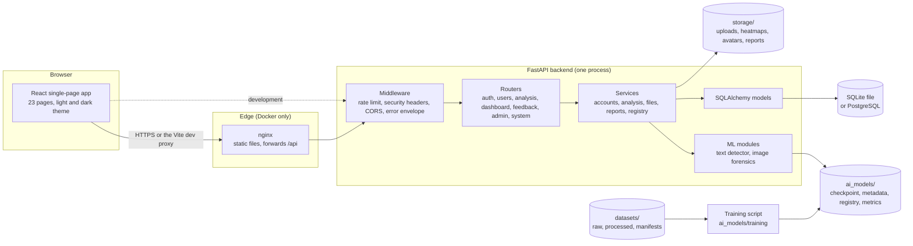
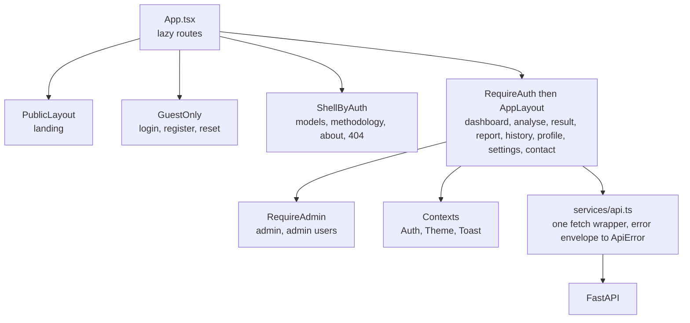

# System architecture

## 1. Overview

The system is a three-tier web application plus an offline training script.

| Layer | Technology | Where |
|---|---|---|
| Interface | React 19, TypeScript, React Router 7, Tailwind CSS 3, Framer Motion, Recharts, Vite 8 | `frontend/` |
| API | FastAPI, Pydantic 2, Uvicorn | `backend/app/` |
| Persistence | SQLAlchemy 2, Alembic, SQLite (default) or PostgreSQL 16 | `backend/app/models`, `backend/alembic` |
| Text model | scikit-learn TF-IDF and logistic regression, joblib | `ai_models/`, `backend/app/ml/text_detection` |
| Image forensics | Pillow (Error Level Analysis and EXIF) | `backend/app/ml/image_detection` |
| News web address | Guarded HTTP fetch, rule-based article extraction, domain list | `backend/app/ml/url_analysis` |
| Evidence | Wikipedia and optional fact-check search, pretrained NLI model (torch, transformers; optional) | `backend/app/ml/fact_checking` |
| Image with text | Pretrained CLIP similarity and a written fusion rule (optional ML packages) | `backend/app/ml/multimodal` |
| Video | OpenCV decoding and YuNet face detection, pretrained frame classifier, score aggregation (optional ML packages) | `backend/app/ml/video_detection` |
| Reports | ReportLab (PDF) | `backend/app/services/reports.py` |
| Packaging | Docker, Docker Compose, nginx | `Dockerfile`, `docker-compose.yml`, `deployment/` |

## 2. Backend structure

The code is layered so that HTTP details, business rules and model code stay apart.

| Layer | Folder | Responsibility | May call |
|---|---|---|---|
| Routers | `app/api/routers/` | Parse requests, check permissions with dependencies, return schemas | services |
| Dependencies | `app/api/deps.py` | Database session, authentication, `require_admin` | models, security |
| Services | `app/services/` | Business rules: create an analysis, owner-only lookup, file storage, reports, model registry | ml, models |
| ML modules | `app/ml/` | Pure inference. No database, no HTTP | numpy, scikit-learn, Pillow |
| Models | `app/models/entities.py` | Tables and relationships | SQLAlchemy |
| Schemas | `app/schemas/` | Request and response shapes and validation | Pydantic |
| Core | `app/core/` | Settings, security helpers, error envelope | none |
| Middleware | `app/middleware/` | Sliding-window rate limiter | none |

The optional machine-learning packages (`torch`, `transformers`, `opencv-python-headless`, listed in `requirements-ml.txt`) are imported only inside the modules that need them. Without them the application starts and each module reports a reduced, labelled result. The video pipeline runs in the API process with limits on size, length, resolution and time, and at most two analyses at once per process (a third gets `503 BUSY`). Decoding in a separate sandboxed worker is not built (see `limitations.md`).

The news-address fetch is the only place where the server requests a user-supplied address. `url_analysis/fetch.py` allows only http and https on ports 80, 443, 8080 and 8443, resolves the host itself, refuses any non-public address, connects to the address it checked, re-checks every redirect, and limits size and time.

### Request lifecycle

1. The rate limiter counts the request per client address and bucket (general, or the stricter auth bucket).
2. The route's dependencies run: open a database session, read the bearer token, check that it is not revoked, that the account is active and that the password has not changed since the token was issued.
3. The router validates the body with the Pydantic schema. A failure becomes a `422` with a list of `{field, message}`.
4. A service does the work. Errors are raised as `APIError(status, code, message)`.
5. Every error, including unexpected ones, leaves through the same envelope `{"error": {"code", "message", "details"}}`.
6. Security headers are added, and `Cache-Control: no-store` for API paths.

## 3. Security architecture

| Concern | Measure |
|---|---|
| Passwords | bcrypt with 12 rounds by default (lowered only in tests). A dummy hash is checked for unknown accounts so timing does not reveal them. Strength rules: at least 8 characters with a letter and a digit |
| Sessions | Signed JWT with a unique id, an expiry and a password-version claim. Logout stores the id in a revocation table. A password change invalidates older tokens. Disabled accounts are refused even with a valid token |
| Reset tokens | Random, stored only as a SHA-256 hash, single use, short expiry. The same answer is given whether or not the account exists. They are returned in a response only when `EXPOSE_RESET_TOKEN=true`, which the app refuses in production |
| Authorisation | Two roles held in a `roles` table. Admin routes need the admin role. Users see only their own analyses, images and heatmaps, and administrators get the same `404` as anyone else for other people's content |
| Uploads | The file type is decided from the content, not from the name or the declared type. Size and pixel limits stop decompression bombs. Files are stored under random names. Original names are sanitised before display. Avatars are re-encoded |
| Input | Pydantic validation on every body, parameterised queries through the ORM, PDF text is escaped |
| Rate limiting | 120 per minute in general and 10 per minute for authentication routes, per client address. This is in memory, so it is per process |
| Browser | Strict CORS allow-list from settings, `X-Content-Type-Options`, `X-Frame-Options`, `Referrer-Policy` |
| Secrets | `SECRET_KEY` is required in production. In development an unset key becomes a random one for that process. `.env` is git-ignored and `.env.example` holds placeholders only |
| Audit | Sign-ins, logouts, password changes and resets, role changes and deletions are written to `audit_logs` |

Known gaps: there is no e-mail service, so password reset tokens must be delivered by an operator. The in-memory rate limiter does not share state between processes. There is no two-factor authentication and no account lockout beyond rate limiting.

## 4. Model architecture and honesty rules

Each analysis module has one entry in a registry (`backend/app/services/registry.py`, `ai_models/model_registry/`). The registry is the single source for the administrators' Models page, the API and the database's `model_versions` table. Visitors get only a stripped copy (`GET /modules`: status, a plain description, size limits).

| Status | Meaning | Current modules |
|---|---|---|
| `trained_baseline` | A trained model with measured results on held-out and external data | text |
| `pretrained` | A downloaded third-party model, validated here | evidence (stance), image-with-text (CLIP) |
| `heuristic` | Fixed measurements or rules, no learned decision | image (ELA and metadata), news address, and evidence, image-with-text and video when the ML packages are missing |
| `experimental` | Exists and was measured on a small amount of data, not validated | Urdu text, video |
| `unavailable` | Should exist but the file is missing or wrong | shown for the text model if its file is missing |
| `planned` | Not built. The status exists in the registry and the interface for future modules | none at present |

Rules enforced in code and tests:

1. A pickled scikit-learn model is loaded only if the installed scikit-learn version equals the one recorded when it was trained. Otherwise the module reports `unavailable` and a `503` explains how to retrain.
2. Numbers on the administrators' Models page and in the API come from the saved evaluation file. A test compares the registry's metrics with the file.
3. The text module never outputs a class it was not trained on, such as "Misleading".
4. The image module returns no confidence value.
5. An unbuilt module never returns generated output.

## 5. Frontend architecture

- All server calls go through `services/api.ts`, which attaches the token, parses the error envelope and exposes `fieldErrors()` for form messages.
- The administrators' Models page and scoreboard read `/models` and `/models/text/evaluation`, which need an administrator token (401 without one, 403 for a user), so the interface cannot show numbers the backend does not hold and no one else can fetch them. The pages every visitor uses read `/modules`, which holds no model names or numbers.
- Each module page reads its status from the registry. A module that cannot run (for example a video without OpenCV) shows why and offers no analysis button that would fail.
- Design tokens are CSS variables with light and dark themes. Type is Newsreader for headings and Schibsted Grotesk for text. Visible focus rings, reduced-motion support and keyboard operation are part of the base styles.
- A date received from the API without a timezone is read as UTC (the API now always sends one).

## 6. Deployment architecture

| Mode | How | Notes |
|---|---|---|
| Local development | `make setup`, then `make backend` and `make frontend` | SQLite, Vite dev server proxies `/api` to `127.0.0.1:8000`. Tested |
| Docker Compose | `docker compose up --build` | PostgreSQL 16, backend image, nginx image serving the built app and forwarding `/api`. Run once in a Linux sandbox (containers healthy, migrations at start, analyses through nginx); not run on Docker Desktop. Files are also checked statically by tests |
| Volumes | `pgdata`, `storage`, `./ai_models`, `./datasets` | The model checkpoint is not in the image. Train it once and it persists on the host |

## 7. Design decisions and trade-offs

| Decision | Reason | Cost |
|---|---|---|
| Logistic regression is the deployed text model although random forest scored higher on the external set | The term contributions are exact, which gives an honest explanation | Slightly lower external F1 |
| SQLite by default | Zero setup for a student laptop | Single writer, in-memory rate limiter. PostgreSQL is available for production |
| Refuse instead of guess (short text, other scripts, version mismatch, missing model) | A wrong confident answer is worse than "Unverified" | Some inputs get no score |
| Image module reports indicators only | ELA is easily defeated and is not validated as a detector | Less impressive output, but no false claim |
| Private media and owner-only access, even for admins | Submitted articles and images can be sensitive | Admins cannot inspect content when helping users |
| No demo data | Empty dashboards show zeroes instead of invented numbers | First screen looks empty until a first analysis |
| Inference inside the API process | Simple and offline | A large model would need a separate worker |
