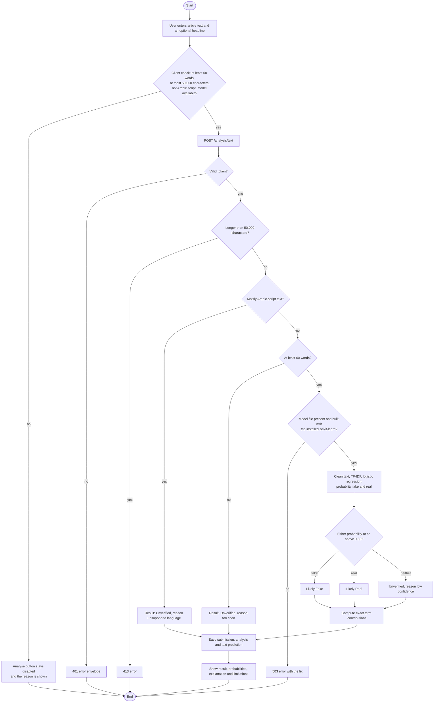
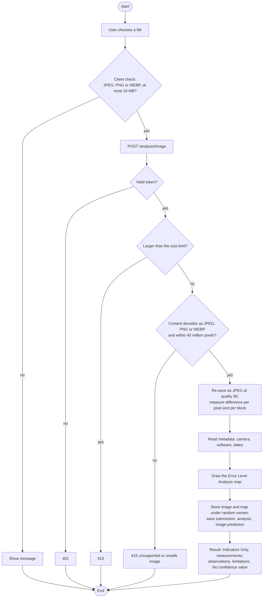
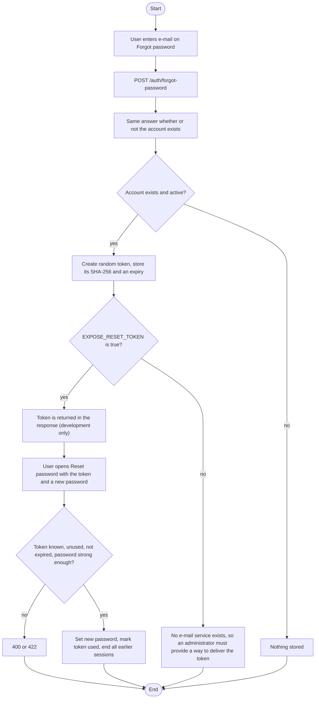
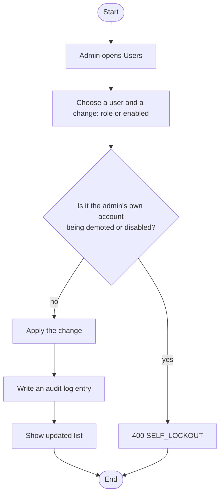

# Activity diagrams

## 1. Analyse a news article (text)

The web page blocks submission of text that is too short, too long or in Arabic script. The API itself accepts such text and answers `Unverified` with the reason, so the later steps in the diagram matter for direct API use.

## 2. Analyse an image

## 3. Password reset

## 4. Administer a user

