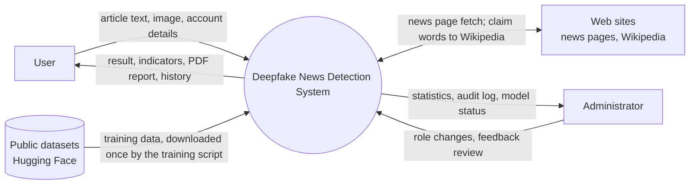
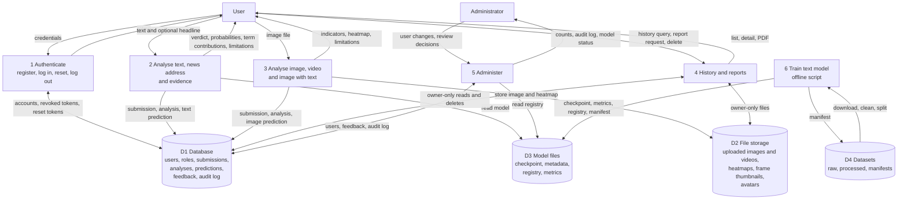

# Data flow diagrams

## Level 0: context

## Level 1

## Notes

- Process 6 is not part of the running server. It is a script (`ai_models/training/train_text_baseline.py`) that writes the files process 2 reads.
- Process 2 (text) and process 3 (image) never send the submitted content to any outside service. The models run inside the backend process.
- The later modules are drawn in the Level 1 diagram as part of processes 2 and 3 for brevity. They differ in what leaves the server: a news web address is fetched from its own site; the evidence check sends the main words of each claim to Wikipedia (and to a fact-check search when a key is set); the video, image-text and evidence models are downloaded from Hugging Face on first use. An uploaded video is stored under a random name, read only by its owner and deleted with the analysis.
