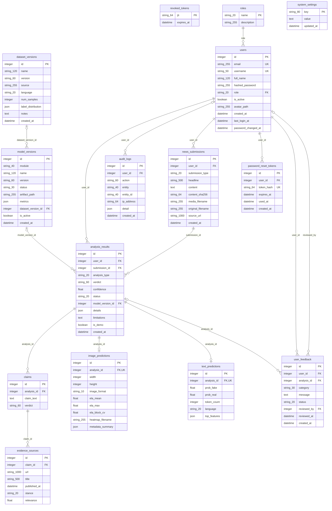

# Entity-relationship diagram

Generated from the SQLAlchemy models, so it matches the migrations (a test compares models and migrations). Rendered by any Mermaid viewer, including GitHub and VS Code.

Reading the diagram: the parent side is `||` (exactly one) when the foreign key is required and `|o` (zero or one) when it can be empty. The child side is `o{` (zero or more) or `o|` (zero or one, used for the one-to-one prediction rows).

