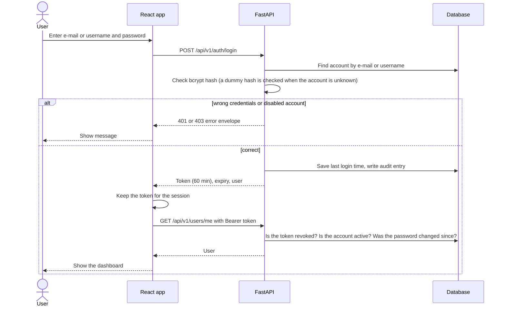
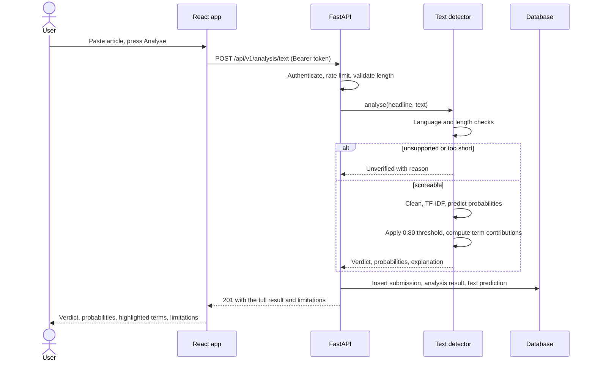
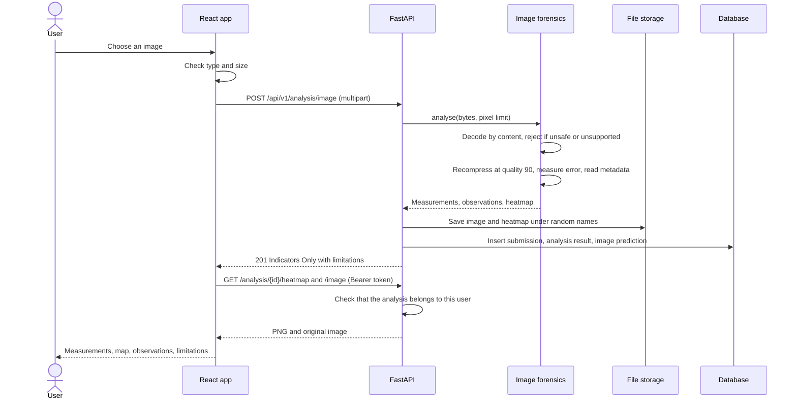
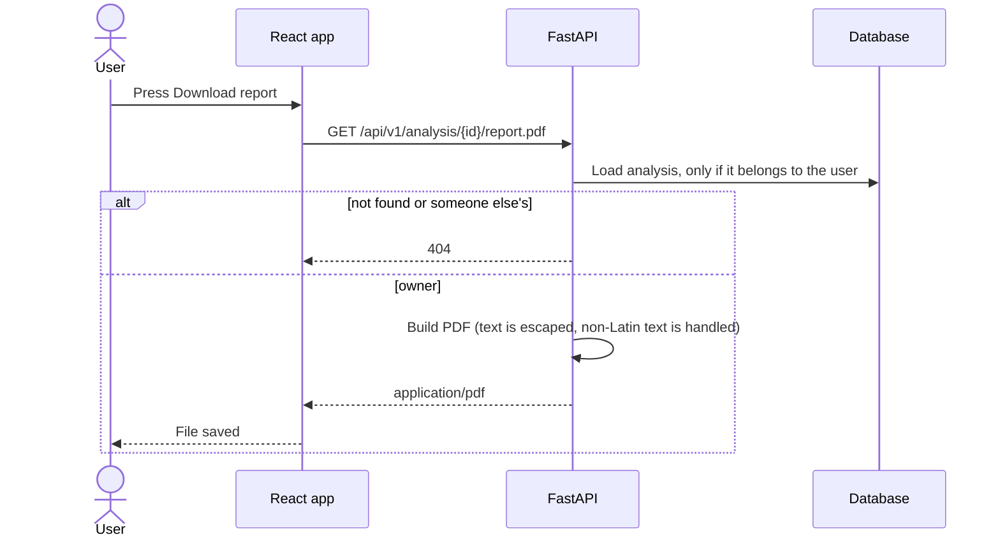
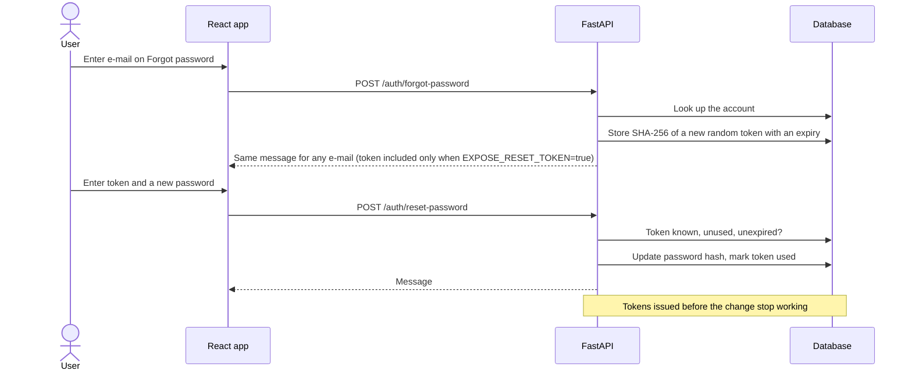
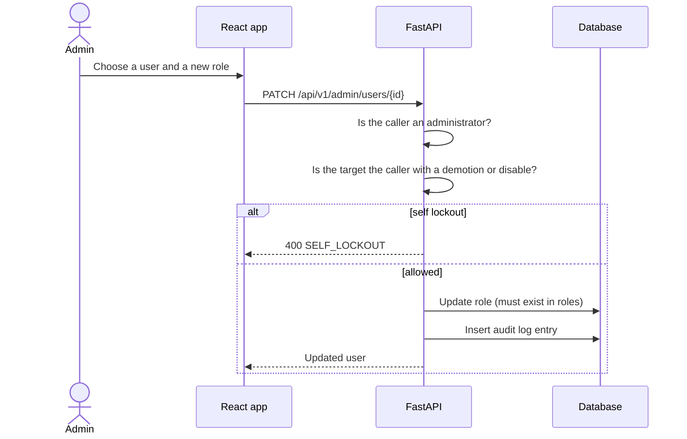

# Sequence diagrams

## 1. Log in and open a protected page

## 2. Analyse text

## 3. Analyse an image

## 4. Download a PDF report

## 5. Reset a password

## 6. Administrator changes a role

