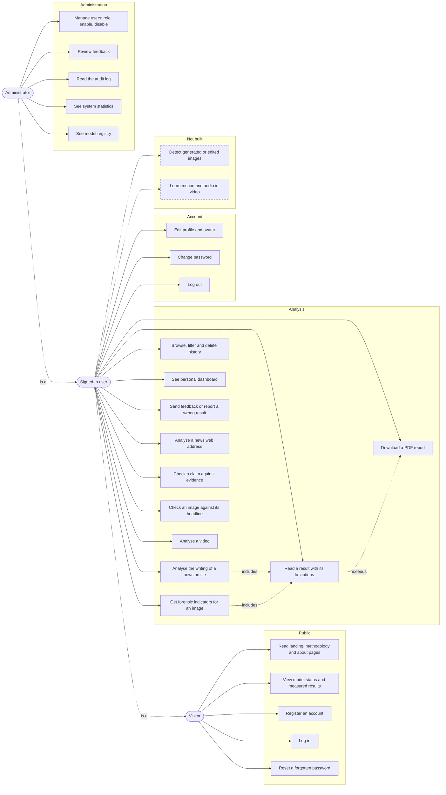

# Use case diagram

Actors are the visitor (not signed in), the signed-in user and the administrator. An administrator is also a user. Use cases drawn with a dashed border are **not built**.

## Rules that the use cases rely on

- A user sees only their own analyses, images and heatmaps. An administrator gets the same `404` for other people's analyses, because admins work from counts and not from content.
- An administrator cannot demote or disable their own account.
- The result of every analysis shows its limitations text.
