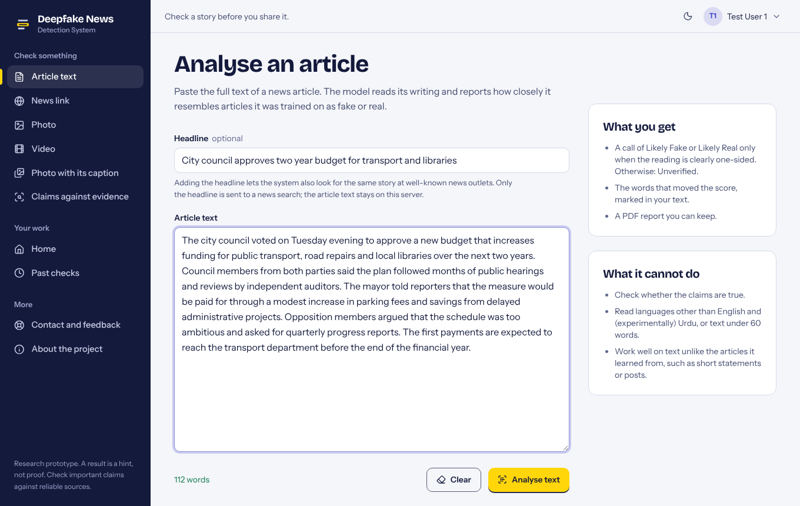
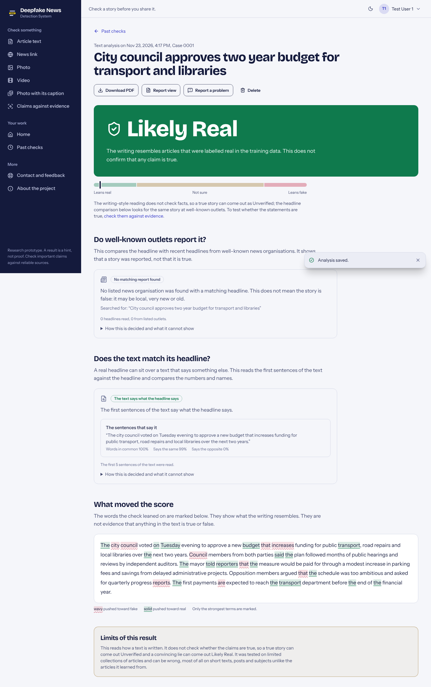
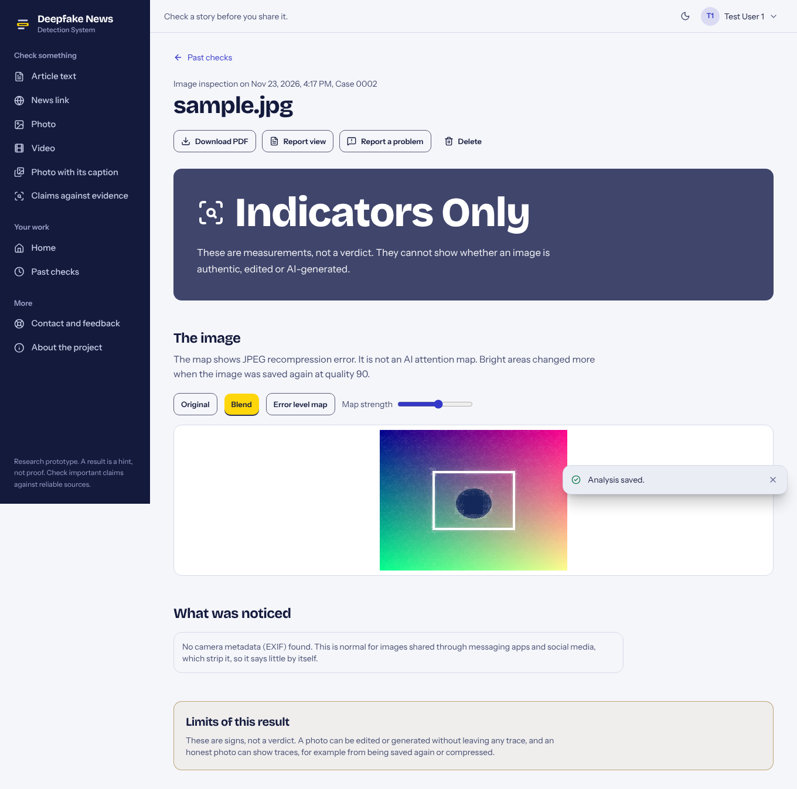
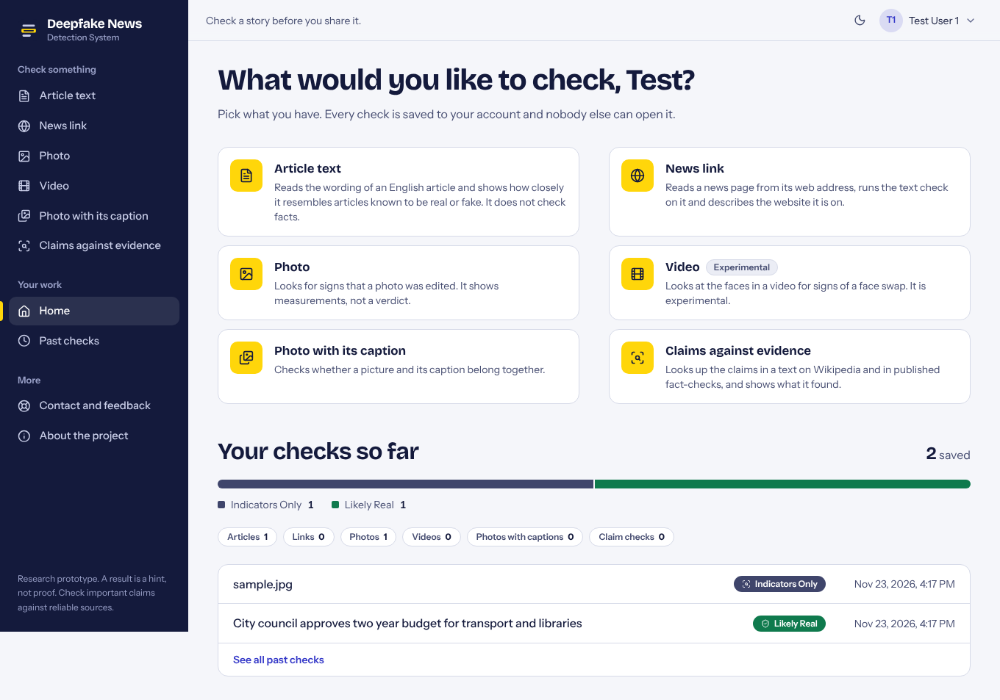
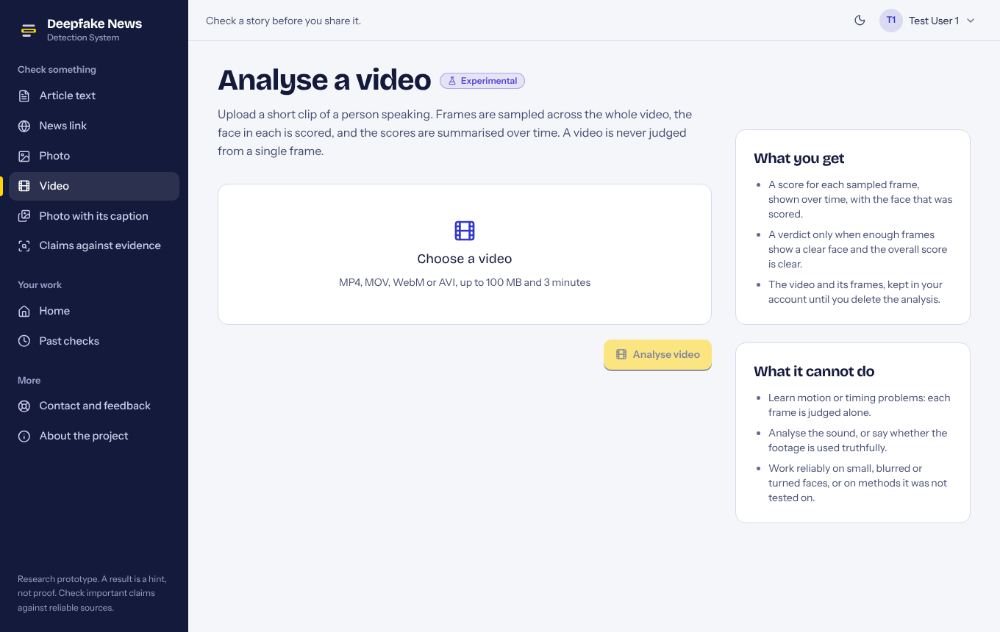
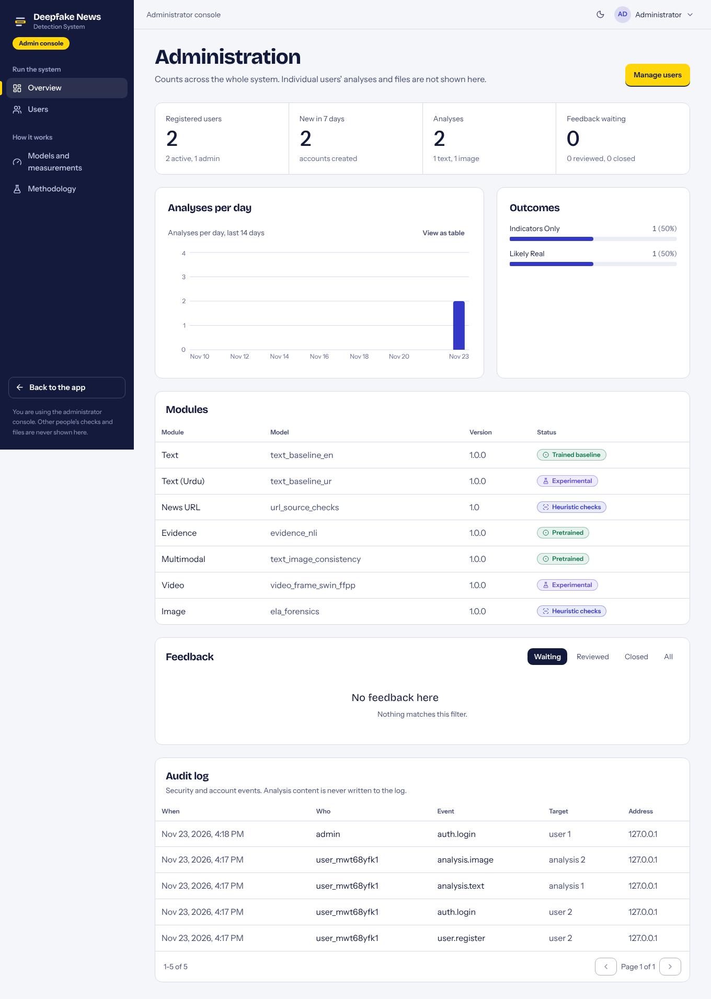
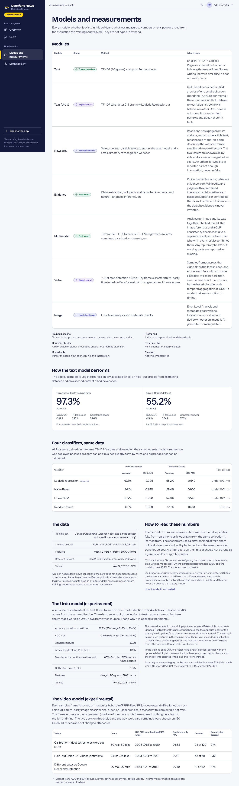
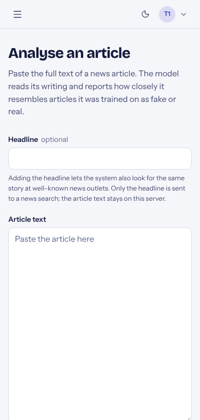

# User manual

This manual explains how to use the Deepfake News Detection System as a reader. Install and start it first: see `installation_manual.md`.

## 1. What the system does and does not do

| It does | It does not |
|---|---|
| Tell you how much an English or Urdu news article's **wording** resembles the articles it learned from, and show which words moved the score | Check whether the claims in an article are true |
| Measure **forensic indicators** in an image (recompression error and camera metadata) | Decide whether an image is authentic, edited or AI-generated |
| Read a **news web address**, score the article and compare the website with a short list of known sites | Call an unfamiliar website fake, or read pages that need a script, a login or a subscription |
| Look for the **headline** among recent reports by well-known news organisations and say whether one reports the same story, or something different | Prove that a story is true, or find old or local stories. *Not found* says nothing against a headline |
| Read the **text** under a headline and say whether it matches the headline (the same subject, the same numbers and names, not the opposite) | Say that a matching text is true, or see false details that come after a text has agreed with its headline |
| Search Wikipedia (and fact-check sites, if the server has a key) for passages about a claim and show whether each supports or contradicts it, with links | Prove a claim. When nothing reliable is found it says **Insufficient Evidence** |
| Check whether an image and its headline fit together, and combine this with the text result by a written rule | Tell whether a photo is real |
| Score the faces in a **video** frame by frame and combine the scores | Learn motion or timing, analyse sound, or give a verdict from too few faces |
| Say clearly when it cannot assess something and why | Hide a missing model or a failed step |

Each module has a status (trained baseline, pretrained, heuristic, experimental or unavailable). Everyone sees whether a check is **Experimental** (measured on a small amount of data, so a lead and not a conclusion) or not available; the full status, the model names and the measured numbers are in the administrator console (section 10).

## 2. Create an account and sign in

1. Open the app (by default http://localhost:5173) and choose **Create account**. You can also paste an article into the box on the home page: you are asked to sign in first and the text is waiting for you afterwards.
2. Enter an e-mail address, a username (3 to 50 letters, digits, `_`, `.` or `-`) and a password of at least 8 characters with a letter and a digit. The rules are checked as you type.
3. After registering, sign in with your e-mail or username.

Forgot your password? Choose **Forgot password** on the sign-in page. This build has no e-mail service, so a reset token can be delivered only by the person who runs the system (see the installation manual). With a token, open **Reset password**, enter it with a new password, and sign in again. Resetting a password ends all other sessions.

Use the account menu (top right) to sign out. Use the moon icon to switch between light and dark themes.

## 3. Analyse an article (Text)

1. Choose **Article text** in the left-hand navigation.
2. Paste the article body. Add the headline if you have it: it lets the system also look for the same story at well-known news outlets (only the headline is sent to a news search; the article stays on the server).
3. The counter shows your word count. The **Analyse text** button is enabled when the text has at least 60 words, is not too long (50,000 characters) and is not in Arabic script such as Urdu. Anything else is shown with the reason.
4. Press **Analyse text**.

### Reading the result

| Part | Meaning |
|---|---|
| Verdict band | **Likely Fake** (red), **Likely Real** (green) or **Unverified** (slate), with one sentence that says what the verdict does not mean. A call is made only when the model puts at least 80% on one side. Otherwise the answer is Unverified. Mismatch flags are amber |
| Bar | Where the model's reading falls: "Leans real", "Not sure", "Leans fake". Ordinary readers see the bar and the words; the percentages are in the administrators' technical details |
| Does the text match its headline? | A separate result, shown when you gave a headline and the text is English. It reads the first sentences of the text against the headline. *The text says what the headline says* is good news but not proof: false details further down are not seen. *The text is about something else* means that a real headline may have been put over another text: a well-known outlet's matching headline is then **not** enough to call the article real, and the verdict stays **Unverified** (this check can only stop a *Likely Real*; it never makes a verdict *Likely Fake*). *The text says something different* and *Names or numbers do not match* are shown as a **warning** and do not change the verdict, because in tests they also appeared on about one real article in seven (an updated story under its first headline, a rounded figure, a model misreading); read both before relying on either. On a page from a listed outlet's own website, every difference is shown but changes nothing, because the outlet wrote both. *The headline is not clearly stated* means the text is about the subject but does not repeat the headline's claim, which is common for quotes and questions, and it changes nothing. The sentences that were compared are shown so that you can read them yourself |
| Do well-known outlets report it? | A separate result. *Reported by listed outlets* means a news organisation from the project's small list ran a headline that says the same, shown with its link and figures. *A listed outlet reports something different* means a very similar headline says the opposite: read it before relying on this story. *No matching report* is not held against the story: it may be local, very new, old or worded differently. When listed outlets reported on the same subject, their headlines are shown as **Related coverage, a different claim**: open them and compare yourself; they do not make the headline true or false. If the news search is busy it says so ("could not be checked"), pauses for about a minute, and the rest of the result is unchanged. This shows that a story was reported, never that it is true. An undecided writing-style reading becomes **Likely Real** only when an outlet reports the same headline; it is never turned into Likely Fake by this check |
| What moved the score | The article with its strongest terms marked. The marks show what the writing resembles. They do not show that any claim is true or false. The two weighted term lists are in the administrators' technical details |
| Limits of this result | What the check cannot do, in plain words. Read it before relying on a verdict |
| Technical details | Administrators only, closed by default: the model's percentages, the word weights, the model name and version with its status, and the model's own statement of its limits |

Important: the same model scored 97% accuracy on articles like its training data and only about 55% on short political statements, where simply answering "fake" every time would have scored about 58%. It learned a writing style. These figures are in the administrator console; every reader is told the plain version in the *Limits of this result* box. Treat a verdict as a hint, never as proof.

### Why you may get Unverified

| Reason shown | What to do |
|---|---|
| Too short | Paste the full article (at least 60 words) |
| Unsupported language | English and (experimentally) Urdu are supported. Text in other languages is declined |
| Low confidence | The model is not sure. This is a normal and honest answer |

## 4. Inspect an image (Image)

1. Choose **Image**. Pick a JPEG, PNG or WEBP file of at most 10 MB.
2. Press **Analyse image**.

The verdict is always **Indicators Only**. There is no confidence value, because these measurements cannot prove anything.

| Part | Meaning |
|---|---|
| Original, Blend, Error level map | Three views of the image. The map shows how much each area changed when the image was saved again as JPEG at quality 90. Bright areas changed more. It is **not** an AI attention map |
| Map strength | Slider for the overlay |
| Measurements | Size and format, mean and highest error level, and how uneven the error is across the image |
| Observations | Plain-language notes, such as whether camera information (EXIF) was found. Missing camera information is normal for pictures shared through social media |
| Limits of this result | Why the indicators cannot tell authentic from edited or generated images |

Recompression error is affected by many harmless things, so an unusual map does not mean an edit and a clean map does not mean authenticity. To check an image's origin, try a reverse image search.

## 5. Results you keep

Each analysis is saved as a numbered case with the date.

| Action | Where |
|---|---|
| Open an earlier result | **Past checks**, then select a case |
| Search and filter | **Past checks**: search by headline or file name, filter by type and verdict |
| Download a PDF report | **Download PDF** on a result |
| Print-friendly view | **Report view** |
| Tell us a result seems wrong | **Report a problem** on a result (opens the contact form with the case attached) |
| Delete | **Delete** on a result. This removes the analysis and any uploaded files and cannot be undone |

Only you can see your analyses and uploaded images. Administrators cannot open them either.

## 6. Home

The home page offers the six kinds of check, each with a plain description. Under them, **Your checks so far** counts your own saved checks and shows how the answers split (green, slate and red, with the words and numbers written out), the number of each kind, and your most recent checks. A new account shows no checks, because nothing is invented.

## 7. Other analyses

All of these results are saved in **Past checks** and can be exported as a PDF report like the others.

### News web address (News link)

1. Choose **News link**, paste the address of an article (`https://...`) in **Article address** and press the analyse button.
2. You get the article text that was read, the text result for its language, and a **website** section: whether the domain is on the known-sites list, look-alike spelling warnings, HTTPS, byline and date.

Pages that need a script, a login or a subscription cannot be read, and the result says so instead of guessing. Internal and private addresses are refused. A site that is not on the list is reported as *unknown*, never as fake. The server contacts the website to fetch the page.

### Evidence (Claims against evidence)

1. Choose **Claims against evidence**, paste a claim or a short passage in **Claim or passage** and press **Check against evidence**.
2. Each claim lists the passages found with a link to each, and whether the passage supports it, contradicts it or neither. The claim verdict is *Supported*, *Contradicted*, *Mixed Evidence* or *Insufficient Evidence*.

Wikipedia is searched, so recent news is usually not found, and the answer is then *Insufficient Evidence*. The main words of each claim are sent to Wikipedia (and to a fact-check search when the server has a key). English only.

### Image with text (Photo with its caption)

1. Choose **Photo with its caption**. Add an image, a headline or caption, an article text, or any combination.
2. Press **Analyse together**. You see the text result, the image measurements, the match between image and text, and the combined verdict with the rule that produced it.

*Mismatch Flagged* means the image and the text clearly do not fit. It does not mean either is false: genuine photos are often used with a loose caption. About one in ten matching captions was flagged in the measurement, and the thresholds were measured on everyday photographs, not news.

### Video

1. Choose **Video** and select an MP4, MOV, WebM or AVI file (up to 100 MB and 3 minutes by default).
2. Press **Analyse video**. Processing time depends on the video and the computer; on a computer without a GPU allow up to a few minutes.
3. The result shows the face frames that were scored, the score of each frame, a chart of the scores over the video, the video score and the verdict (*Likely Fake*, *Likely Real*, *Unverified* or *Indicators Only*).

Read these notes before trusting a result:

- It is **frame-based**: every frame is judged alone and then summarised. It does not learn motion, flicker or lip-sync, and it does not listen to the sound.
- At least 8 frames with a clear face are needed. Videos without enough faces get no verdict.
- It was measured on tens of videos from two research datasets. On the second one, about one decided video in five was wrong. It was not tested on news broadcasts, heavy compression or tools other than face swaps.
- The first video analysis downloads a model of about 110 MB (internet needed once).

## 8. About the project

**About the project** (open to everyone, also before signing in) explains why the project exists, how to read an answer, what each check does, who built it and what it cannot do. The technical pages are not part of the public site: the model registry, the measured results, the methodology and the list of technology are in the administrator console (section 10), and the server refuses those requests from anyone who is not an administrator.

## 9. Profile, settings and feedback

- **Profile**: change your name and username, set or remove a profile picture, change your password.
- **Settings**: appearance (the theme is stored on this device), change password, and sign out.
- **Contact and feedback**: report a bug, a wrong result, a feature request or anything else. The same page lists your earlier messages and whether they were reviewed.

## 10. For administrators

An administrator sees an **Admin console** button at the bottom of the left-hand navigation. It opens a separate area with its own navigation and an **Admin console** badge, and **Back to the app** returns to the everyday pages. Ordinary users never see the button; if they type an admin address they are sent home, and the server refuses the requests behind those pages (answer 403).

| Page | What it offers |
|---|---|
| Overview (`/admin`) | Counts across the system (users and analyses, analyses per day, outcomes), the status of each module, feedback with review actions (mark as reviewed or close), and the audit log |
| Users (`/admin/users`) | Search users, make someone an administrator or remove that role, enable or disable an account. You cannot demote or disable yourself |
| Models and measurements (`/admin/models`) | The model registry with names and versions, the measured results of the text, Urdu, evidence and video models, the comparison of classifiers, the data used and the known limits |
| Methodology (`/admin/methodology`) | How each result is produced and tested, what is not built, privacy, and the technology used |

On a result page an administrator also gets a closed **Technical details** section with the model's percentages, the word weights, the image measurements, the model name and the model's own statement of its limits.

**What an administrator can change from the interface:** user roles, whether an account is active, and the status of feedback. Everything else is set by the person who runs the system, in the `.env` file: the first administrator (`ADMIN_EMAIL` and `ADMIN_PASSWORD`, used the first time the server starts on an empty database), the strictness of the headline-text comparison (`TEXT_MATCH_STRICT`), the size limits, rate limits, and which checks are switched on. See the installation manual.

Administrators see counts and logs, not other people's articles or images.

## 11. Mobile use

The layout adapts to narrow screens, and the left-hand navigation becomes a menu.

## 12. Troubleshooting

| Message or symptom | Cause and fix |
|---|---|
| "The text model is not available" or a 503 error mentioning scikit-learn | The model file is missing or was trained with a different scikit-learn. Run `bash scripts/training/train_text_model.sh` (about 2 minutes after the first download) |
| "Too many requests" | You hit the rate limit. Wait a minute |
| "Unsupported image" | Use a real JPEG, PNG or WEBP file under 10 MB. The file content is checked, not just its name |
| You are signed out unexpectedly | The session lasts 60 minutes, or the password was changed, or the server restarted without a fixed `SECRET_KEY` in development |
| A time looks wrong | Times are stored in UTC and shown in your local time zone |
